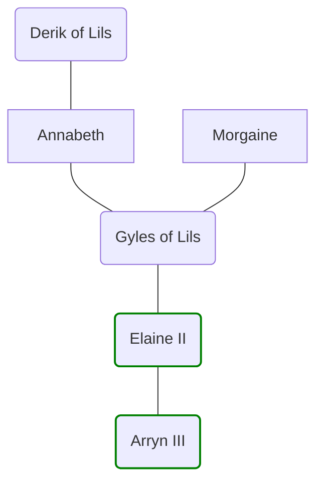

```taelgar-header
```

A cadet branch of the [[House of Sewick]], which came to the throne in the 1720s. The house descends from the youngest child of [[Elaine I]] and a Tyrwinghan [[Oracle of the Riven]], [[Morgaine]].




```taelgar-index
type: members
mode: table
show: obsidian
```
%% Note: More could be invented about this house, but little needs to be. Mostly exists to group the recent Sembaran/Tyrwinghan rulers. %%

%%^Metadata:names:v1%%
- {"name": "House of Lils", "language": "unknown", "pronunciation": "HOUSE uv LILZ", "status": "proposed", "notes": "Proposed using the English component of the Sembaran French/English analogue in [[Languages]]: ordinary House of, short i in Lils, and final s voiced as z. Exact name language is unrecorded; a French-influenced LEEL with silent final s is a possible alternative."}
%%^End%%

%%^povNotes:v1%%
Temporal coverage: a modern retrospective of the cadet branch and its rise to the Sembaran throne in the 1720s, with selected genealogical relationships rather than a continuous dynastic history.
%%^End%%

%%^Lint%%
## Taelgar note lint

### Applied changes
- Normalized frontmatter, recorded the explicit subject name, and added persistent name and temporal metadata.
- Canonicalized the private-block sentinel after verifying identical export visibility.

### Validated judgments
- The existing descent paragraph and diagram perform the note’s limited genealogical role. [[Derik of Lils]], [[Annabeth]], and [[Elaine II]] corroborate the family chain without requiring a broader invented dynastic history.

### Open findings

- [ ] **Warning — metadata.names_unresolved_status:** Review the complete proposed pronunciation `HOUSE uv LILZ`. The Sembaran guidance in [[Languages]] supplies English and French analogues; the preferred English reading uses short i and a voiced final s, with ordinary House of. A French-influenced `HOUSE uv LEEL` with a silent final s is also plausible. Neither the source language of Lils nor a specific pronunciation is recorded in the consulted family notes. Accept or replace the proposal before marking it documented and copying it to frontmatter.
%%^End%%
