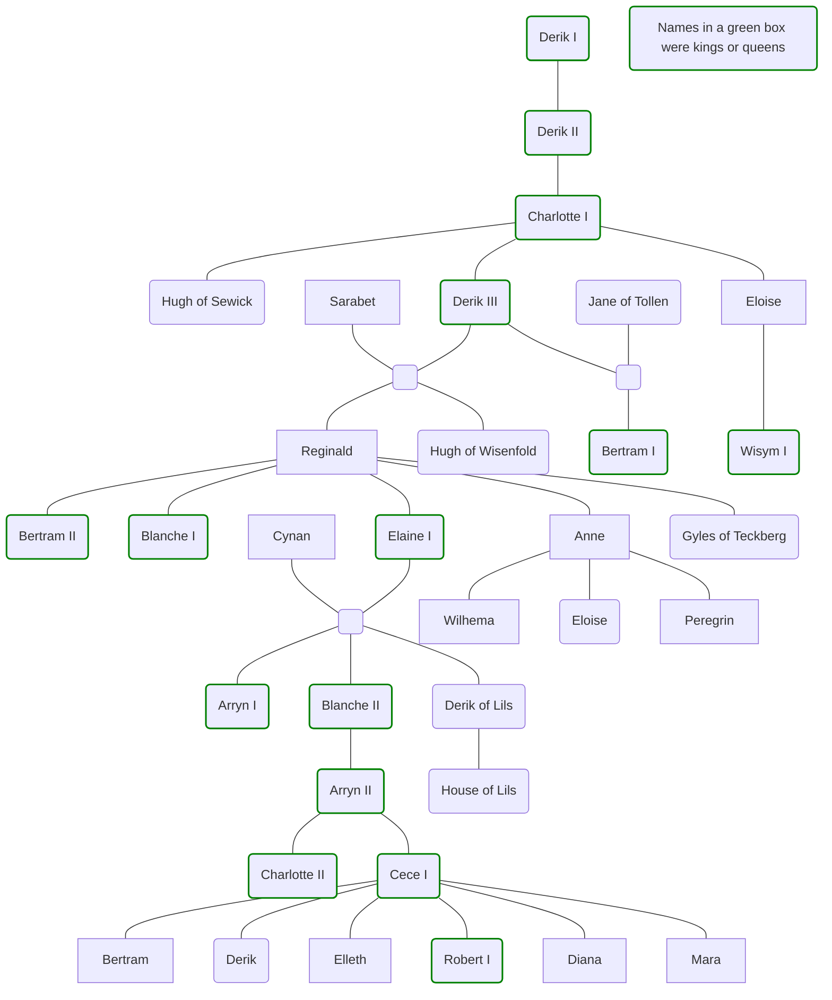

# The House of Sewick
>[!info]+ Information
> A [[Sembara|Sembaran]] noble house
> `$=dv.view("_scripts/view/get_PageDatedValue")`
> `$=dv.view("_scripts/view/get_Affiliations")`

The founding royal house of modern [[Sembara]], the House of Sewick ruled between the 1420s and the 1720s. A cadet branch, the [[House of Lils]] rules today.




%%^Campaign:none%%
### Members

```dataviewjs
const { util } = customJS
dv.table(["Person", "Info", "Born", "Died"], 
			dv.pages("#person")
				.where(f => util.isOrWasAffiliated(dv.current().file.name, f.file))
				.sort(b => b.born)
				.map(b => [util.s("<name> (<pronouns> <pronunciation>)", b.file, dv.current().pageTargetDate), util.s("<ancestry> <maintype>", b.file, dv.current().pageTargetDate), util.s("<startStatus> <startDate>",b.file, dv.current().pageTargetDate), util.s("<endStatus> <endDate>",b.file, dv.current().pageTargetDate)]))
```
%%^End%%

%%^Metadata:names:v1%%
- {"name": "House of Sewick", "language": "Sembaran", "pronunciation": "HOUSE of SEH-wik", "status": "proposed", "notes": "The Sewick component follows the existing proposed reading in [[Anne]], using the English strand of the Sembaran analogue in [[Languages]]: short e and i, sounded w, hard final k, and first-syllable stress. It is not an accepted pronunciation; inherited place-name readings could differ."}
%%^End%%

%%^povNotes:v1%%
Temporal coverage: a modern retrospective genealogy after the House of Lils succeeded the Sewick rulers in the 1720s; the chart supplies selected earlier relationships rather than continuous political history.
%%^End%%

%%^Lint%%
## Taelgar note lint

### Applied changes
- Normalized frontmatter order and collection formatting.
- Added persistent name metadata and the article’s POV and temporal-coverage note.
- Normalized `Campaign:None` to `Campaign:none`; the current exporter casefolds both to the same private sentinel, preserving filtered visibility.

### Validated judgments
- No additional validated judgments.

### Open findings

- [ ] **Warning — metadata.names_unresolved_status:** Confirm the proposed full pronunciation `HOUSE of SEH-wik` in `Metadata:names:v1`. The Sewick component follows the still-proposed reading in [[Anne]] and the English strand of the Sembaran analogue in [[Languages]]: short e/i, sounded w, hard final k, and first-syllable stress. It is not accepted merely because another note proposes it; inherited place-name readings remain possible. Accept it by copying it to frontmatter and marking the entry documented, or supply the intended pronunciation.

%%^End%%
