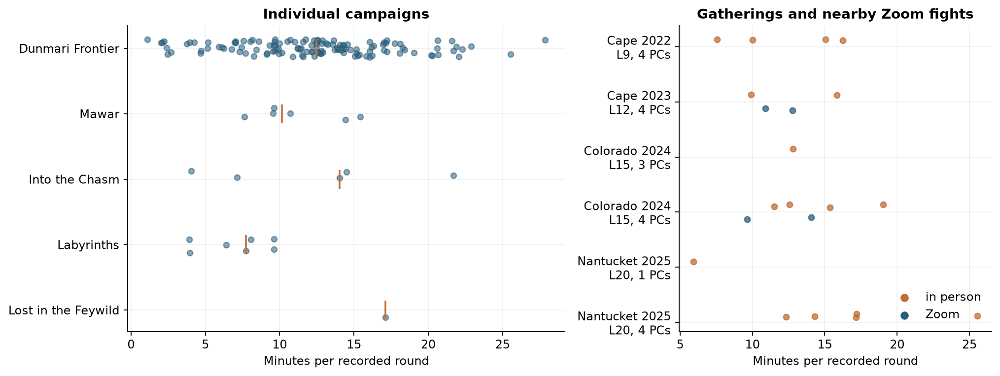
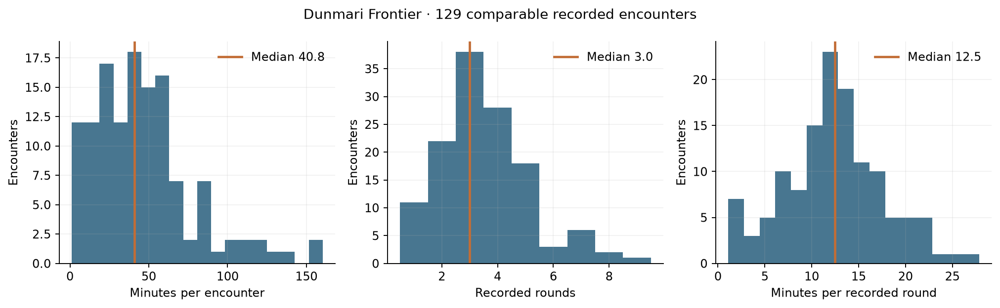
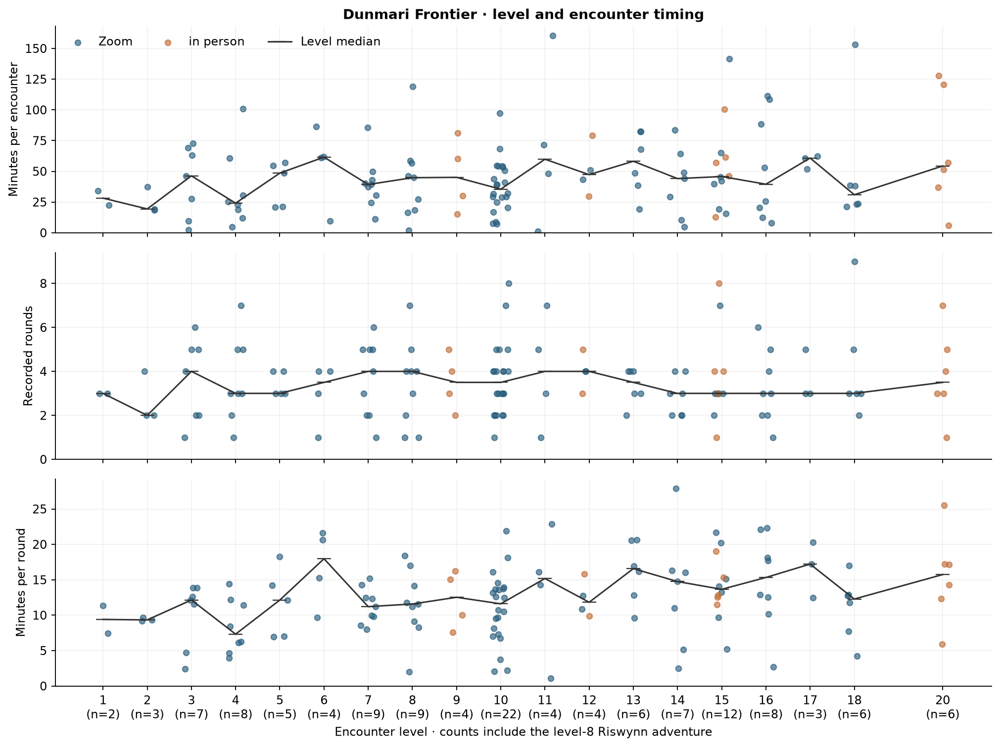
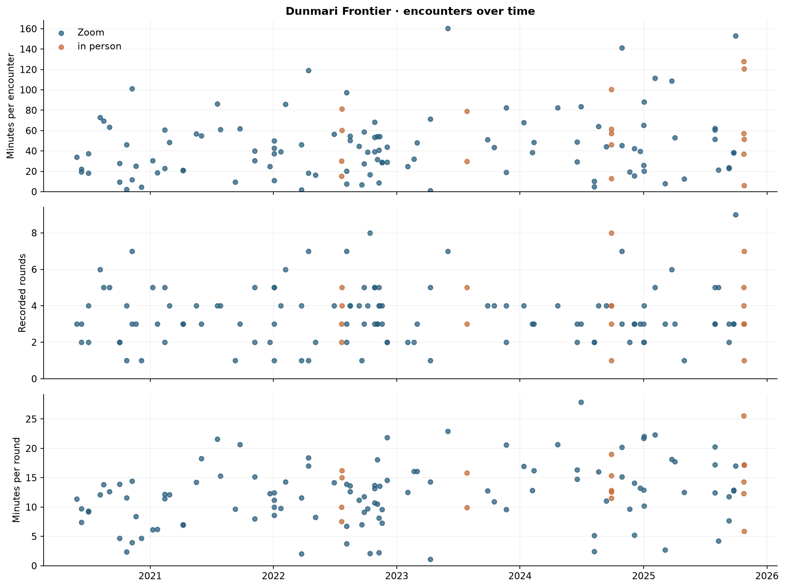
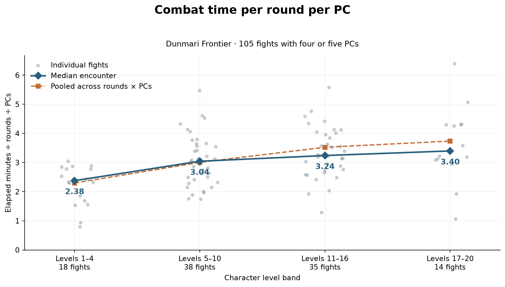
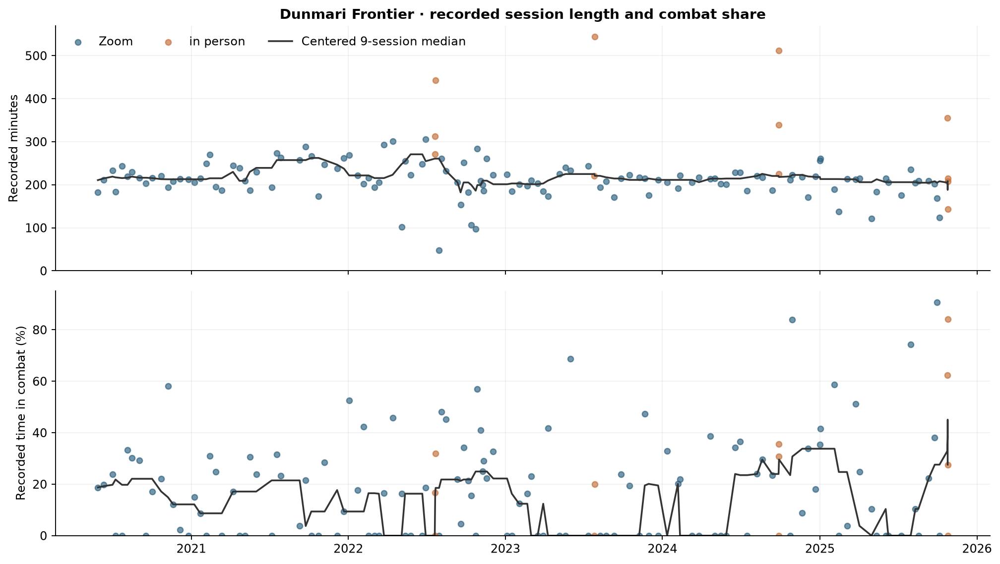

# Initial combat analysis

Built from current session artifacts using metadata decisions dated 2026-11-06.

Dunmari Frontier has 136 timed sessions and 131 recorded combat segments. The comparable speed sample contains 129 encounters. Its median encounter takes **40.8 minutes** across **3.0 recorded rounds**. The median encounter averages **12.5 minutes per round**. Pooling all elapsed minutes and recorded rounds gives **13.0 minutes per round**. The middle half of encounters fall between 9.3 and 15.4 minutes per recorded round.

## Coverage and definitions

The tables cover 160 registered sessions in five campaigns, with 156 timed sessions and 150 recorded combat segments. Dragonets is excluded at the user’s request. A missing combat extraction has blank counts and times. A complete extraction with no combat has zero counts and combat time.

A session’s recorded length is the extent from the earliest timestamp to the latest timestamp. Combat duration is elapsed time inside each classified combat segment, including setup, tactical discussion, rules, interruptions and internal pauses. Overlapping milliseconds belong to the earliest source block, following the existing review renderer. Gaps between segment blocks are reported separately. `combat_share_recording_pct` uses the recording extent as denominator. `combat_share_classified_pct` uses the sum of classified block durations.

Rounds are the cycles recorded by the combat extractor. Final cycles can be partial, and narration sometimes compresses an ending. These measurements describe average time per recorded cycle. They do not locate or time individual round boundaries. The main speed summaries exclude the remotely watched fight and the colossus encounter with ten-minute action cycles in session 104. Both remain in encounter counts and session combat-time totals. Environmental challenges, brief standoffs, direct PC conflict, the compelled-PC intervention and the evacuation remain included and have explicit `encounter_kind` labels.

All comparisons are descriptive. Level changes alongside real-world date, party composition, enemy design, rules and table experience. Encounters within a session or a gathering share conditions. No independent-sample significance test or causal level or format effect is asserted.

## Campaign comparisons

| Campaign | Registered | Timed | Recorded fights | Timed sessions without combat | Median recorded minutes | Pooled recorded combat share |
| --- | --- | --- | --- | --- | --- | --- |
| Dunmari Frontier | 139 | 136 | 131 | 51 | 214.5 | 19.9% |
| Mawar Adventures | 5 | 4 | 6 | 0 | 267.8 | 30.7% |
| Into the Chasm | 6 | 6 | 5 | 2 | 178.3 | 23.1% |
| Labyrinths of the Lost | 3 | 3 | 7 | 0 | 214.4 | 22.1% |
| Lost in the Feywild | 7 | 7 | 1 | 6 | 181.7 | 4.2% |

| Group | Fights | Sessions | Median minutes/fight | Median rounds | Median minutes/round | Pooled minutes/round |
| --- | --- | --- | --- | --- | --- | --- |
| Dunmari Frontier | 129 | 85 | 40.8 | 3.0 | 12.5 | 13.0 |
| Mawar Adventures | 6 | 4 | 50.8 | 5.0 | 10.2 | 10.9 |
| Into the Chasm | 5 | 4 | 56.1 | 4.0 | 14.0 | 11.9 |
| Labyrinths of the Lost | 7 | 3 | 15.7 | 3.0 | 7.7 | 7.0 |
| Lost in the Feywild | 1 | 1 | 51.4 | 3.0 | 17.1 | 17.1 |

The campaign rows retain differences in level, DM, party size and adventure premise. Into the Chasm and Lost in the Feywild have different DMs from the Dunmari, Mawar and Labyrinths games. Mawar and Into the Chasm are level 6 throughout. Labyrinths advances from level 2 to 3 during its first session. Lost in the Feywild is level 3. Labyrinths session 2 has an acknowledged recording omission containing an additional fight. Its totals and the campaign comparison describe surviving recorded play.

## Combat length, rounds and speed

The separate duration and round measurements help distinguish an encounter that takes more rounds from an encounter that spends longer on each round. Median minutes per round gives each encounter one observation. Pooled minutes per round weights the result by recorded rounds.

## Level and elapsed campaign time

| Group | Fights | Sessions | Median minutes/fight | Median rounds | Median minutes/round | Pooled minutes/round |
| --- | --- | --- | --- | --- | --- | --- |
| Level 1 | 2 | 2 | 28.2 | 3.0 | 9.4 | 9.4 |
| Level 2 | 3 | 2 | 19.4 | 2.0 | 9.3 | 9.4 |
| Level 3 | 7 | 5 | 46.3 | 4.0 | 12.1 | 11.6 |
| Level 4 | 8 | 6 | 24.1 | 3.0 | 7.3 | 9.5 |
| Level 5 | 5 | 4 | 48.5 | 3.0 | 12.1 | 11.9 |
| Level 6 | 4 | 4 | 61.5 | 3.5 | 18.0 | 18.3 |
| Level 7 | 9 | 5 | 39.3 | 4.0 | 11.2 | 11.0 |
| Level 8 | 9 | 6 | 44.8 | 4.0 | 11.6 | 12.6 |
| Level 9 | 4 | 2 | 45.1 | 3.5 | 12.5 | 13.3 |
| Level 10 | 22 | 13 | 35.5 | 3.5 | 11.6 | 10.4 |
| Level 11 | 4 | 3 | 59.8 | 4.0 | 15.2 | 17.6 |
| Level 12 | 4 | 3 | 47.3 | 4.0 | 11.8 | 12.7 |
| Level 13 | 6 | 5 | 58.2 | 3.5 | 16.6 | 17.0 |
| Level 14 | 7 | 5 | 44.1 | 3.0 | 14.7 | 14.3 |
| Level 15 | 12 | 7 | 45.8 | 3.0 | 13.7 | 14.7 |
| Level 16 | 8 | 7 | 39.5 | 3.0 | 15.3 | 16.5 |
| Level 17 | 3 | 1 | 60.8 | 3.0 | 17.2 | 15.9 |
| Level 18 | 6 | 4 | 30.9 | 3.0 | 12.3 | 11.9 |
| Level 20 | 6 | 3 | 54.4 | 3.5 | 15.7 | 17.4 |

| Group | Fights | Sessions | Median minutes/fight | Median rounds | Median minutes/round | Pooled minutes/round |
| --- | --- | --- | --- | --- | --- | --- |
| Levels 1–4 | 20 | 14 | 26.5 | 3.0 | 9.5 | 10.3 |
| Levels 5–10 | 53 | 34 | 39.4 | 4.0 | 11.8 | 11.7 |
| Levels 11–16 | 41 | 29 | 48.2 | 3.0 | 14.3 | 15.4 |
| Levels 17–20 | 15 | 8 | 51.5 | 3.0 | 12.9 | 14.8 |

| Level band, four or five PCs | Fights | Median minutes/round/PC | Pooled minutes/round/PC |
| --- | --- | --- | --- |
| Levels 1–4 | 18 | 2.38 | 2.30 |
| Levels 5–10 | 38 | 3.04 | 3.01 |
| Levels 11–16 | 35 | 3.24 | 3.52 |
| Levels 17–20 | 14 | 3.40 | 3.74 |

The full-party graph includes four or five roster PCs taking recorded regular turns, including guest parties. Each gray point is one encounter’s elapsed minutes divided by its recorded rounds and PC count. The blue line gives each encounter equal weight. The dashed orange line divides total elapsed minutes by the sum of rounds × PCs. Elapsed time includes enemies, summons, discussion and pauses throughout the encounter.

Levels 1–4 have a median encounter duration of 26.5 minutes, 3.0 rounds and 9.5 minutes per round. Levels 17–20 have corresponding medians of 51.5 minutes, 3.0 rounds and 12.9 minutes per round. The ratio of median minutes per round is 1.35. The figures show the within-level spread and the concentration of in-person play at particular levels. The median round count is three in both the lowest and highest bands. The level relationship has substantial variation, including a lower median pace in levels 17–20 than in levels 11–16. No timed level-19 combat is available in the current archive.

| Level band, Zoom with four roster PCs taking turns | Fights | Median minutes/round |
| --- | --- | --- |
| Levels 1–4 | 9 | 9.3 |
| Levels 5–10 | 22 | 12.2 |
| Levels 11–16 | 10 | 12.6 |
| Levels 17–20 | 9 | 12.8 |

Restricting to Zoom encounters with four roster PCs taking recorded turns produces a similar broad increase. This restriction accounts for two measured differences between encounters. Enemy composition, summons, objectives and incomplete or compressed turn reporting still vary.

The level-8 group includes Riswynn and her level-8 guests in sessions 56 and 58. Other split-adventure PCs and guests are level 10. Session 49’s fight is level 8, following the user’s clarification about Kenzo’s early level-9 benefit. Session 2’s first fight is level 1 and its second is level 2. Session 116’s Fausto fight is level 15 and its Apollyon fight is level 16. The dated advancement list places level 15 after the Eldest in session 106. Session 107’s note repeats that milestone. The session 106 fight remains level 14.

## In person and Zoom

| Group | Fights | Sessions | Median minutes/fight | Median rounds | Median minutes/round | Pooled minutes/round |
| --- | --- | --- | --- | --- | --- | --- |
| Zoom | 112 | 77 | 39.5 | 3.0 | 12.4 | 12.7 |
| in person | 17 | 8 | 57.1 | 4.0 | 14.3 | 15.0 |

The pooled format comparison combines different levels and party configurations. The following comparison uses Zoom fights within 180 days of each gathering, at the same level and with the same number of roster PCs explicitly taking regular turns. Split adventures are excluded. Counts of roster PCs taking turns are observations from action entries. They can omit PCs who do not take a recorded regular turn and exclude allied NPCs and summons.

| Gathering | Level | Roster PCs taking turns | In-person fights | Zoom fights | In-person median min/round | Zoom median min/round | In-person / Zoom |
| --- | --- | --- | --- | --- | --- | --- | --- |
| Cape 2022 | 9 | 4 | 4 | 0 | 12.5 | — | — |
| Cape 2023 | 12 | 4 | 2 | 2 | 12.9 | 11.8 | 1.09 |
| Colorado 2024 | 15 | 3 | 1 | 0 | 12.8 | — | — |
| Colorado 2024 | 15 | 4 | 4 | 2 | 14.0 | 11.9 | 1.18 |
| Nantucket 2025 | 20 | 1 | 1 | 0 | 5.9 | — | — |
| Nantucket 2025 | 20 | 4 | 5 | 0 | 17.2 | — | — |

The level-9 Cape 2022 and level-20 Nantucket 2025 fights have no same-level Zoom comparison in this archive. Cape 2023 and Colorado 2024 supply the overlapping conditions. Treat each gathering as one shared playing context when interpreting the multiple encounters. The table reports every available matching stratum, including ones without a Zoom counterpart. The two matched four-PC strata have in-person medians about 9% and 18% above their Zoom comparison medians. Each Zoom comparison contains only two fights. This archive therefore supplies little precision for a general format effect.

## Session totals and changes over time

| Year | Timed sessions | Recorded fights | Median recorded minutes | Pooled combat share | Sessions without recorded combat | Median minutes/round |
| --- | --- | --- | --- | --- | --- | --- |
| 2020 | 15 | 16 | 213.0 | 17.8% | 4 | 9.5 |
| 2021 | 21 | 16 | 239.2 | 13.3% | 8 | 12.1 |
| 2022 | 31 | 39 | 223.1 | 23.2% | 9 | 11.2 |
| 2023 | 23 | 12 | 211.3 | 12.6% | 14 | 13.5 |
| 2024 | 23 | 24 | 216.9 | 21.7% | 8 | 14.4 |
| 2025 | 23 | 24 | 208.0 | 29.3% | 8 | 13.6 |

Yearly median recorded session length stays between roughly 208 and 239 minutes. Combat share varies much more. In 2023, 14 of 23 timed sessions have no recorded combat and pooled combat share is 12.6%. In 2025, pooled combat share reaches 29.3%, including the long final gathering. These are differences in the recorded time budget across campaign phases.

The plotted trend is a centered nine-session median, with shorter windows at the ends. Calendar-year summaries have unequal numbers and lengths of sessions. The short split adventures and long in-person gatherings remain visible in the individual-session points. A short timestamp extent alone cannot establish whether the recording covered the complete real-world meeting.

## Qualifications and source checks

| Session / encounter | Treatment |
| --- | --- |
| dunmari-frontier-104/c001 | The party watches through scrying. The fight is already underway, so only the observed portion is recorded. |
| dunmari-frontier-104/c002 | Recorded cycles include ten-minute Radiance holds. The denominator does not represent ordinary combat rounds. |
| dunmari-frontier-064/c001 | Ordered action cycles resolve passage through the vortex. Retained under the current combat classification. |
| into-the-chasm-006/c001 | One initiative cycle stops a compelled descent. Retained under the current combat classification. |
| into-the-chasm-006/c002 | Repeated ordered actions resolve the evacuation. Closing cycles are compressed in narration. |
| dunmari-frontier-075/c002 | A genuine one-minute initiative exchange resolves Kenzo striking Wellby. Retained under the current combat classification. |
| dunmari-frontier-043/c001 | Initiative orders a horn signal and intimidation. The scouts flee or surrender after about two minutes. |

All present segment and combat inputs were checked against the current manifest and polished transcript hashes. The existing loader and recording-time implementation verify UID coverage, whole-turn boundaries and recording timestamps. Each encounter has a matching combat segment and consecutive recorded round numbers. The sum of encounter durations matches session combat time exactly before CSV rounding. Source hashes in both tables allow later analysis to identify changed inputs.

The initial source audit checked start and end passages for 14 encounters, including the shortest exchanges, longest fights, largest minutes-per-round values and ordinary comparison cases. The brief PC strike and bandit intimidation are supported by initiative and resolved actions. The longest fight, Kadmos at the palace, continues until the explicit end of initiative. Large late-game fights retain continuous phases or an immediate rescue inside their existing boundaries. All 156 recording extents and combat totals also matched the current per-session reviews within one second of displayed rounding. This audit checks boundary plausibility and timing. It retains the existing round reconstruction.

Dunmari sessions 96 and 107 have narrative sources, and session 135 has raw notes. Mawar episode 1 has a narrative source. Their missing timed extractions are retained as unavailable session rows. Session 135’s Impossible Tower battle therefore contributes no timed encounter to this report. Labyrinths session 2 carries its recording-omission qualification on both session and encounter rows.

Session 116’s continuous timing repair was present before this analysis began. Its registered source offsets the second Zoom recording by 4:07:01.760. No additional offset is applied by this script.

## Reproduce and inspect

Run `python analyze.py` from this directory with PyYAML and matplotlib installed. Run `python analyze.py --check` to recompute and compare the CSV and report text without writing files. The script verifies that inputs remain unchanged during the calculation. Plotting uses a fixed jitter seed.

The analysis uses the repository’s existing transcript loader and recording-time functions. Output columns preserve source paths and SHA-256 fingerprints. Level milestones, human clarifications, play-format evidence and encounter qualifications are maintained in `metadata.yaml`. Enemy rosters are draft analysis annotations in `enemy-rosters.yaml`, derived from the existing combat records with checks for allies, summons, changing sides and overlapping actor labels. Each annotation is bound to the exact semantic combat record. A changed record requires reinspection of its roster.

The full [combat table with enemy lists](combat-table.md) includes all recorded encounters, with PC count, elapsed time, rounds and minutes per round per PC. `four_or_five_pcs` in the CSV selects the subset used in the normalized full-party graph.

Inputs and outputs are available in [sessions.csv](sessions.csv), [encounters.csv](encounters.csv), [metadata.yaml](metadata.yaml) and [analyze.py](analyze.py). The timing implementation is [render_review.py](../../../.agents/skills/extract-session-structure/scripts/render_review.py).
